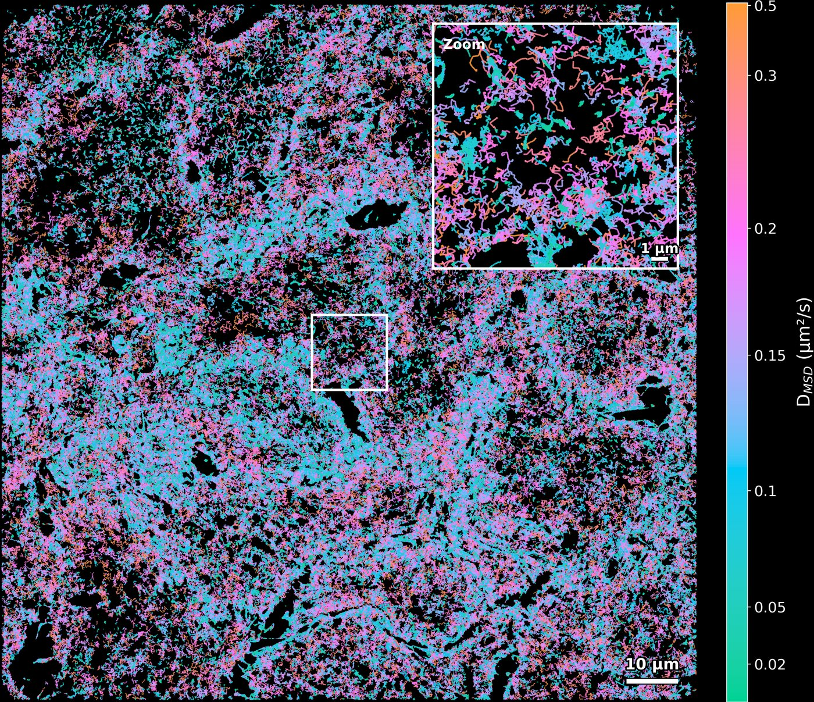
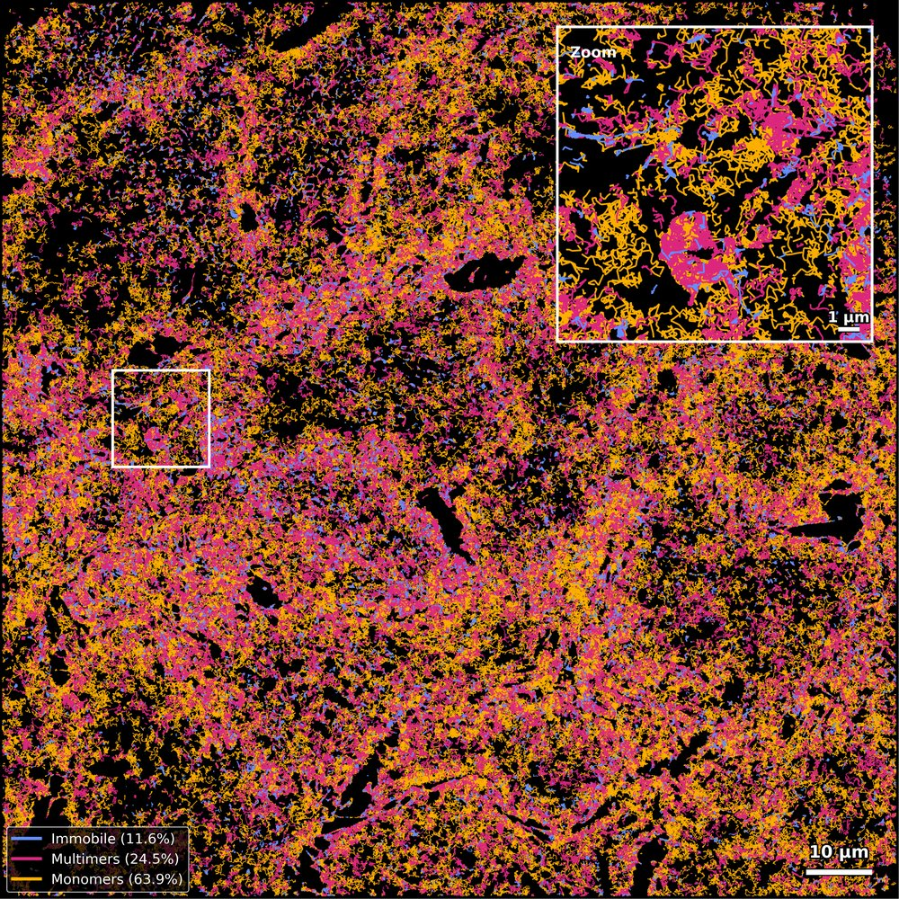
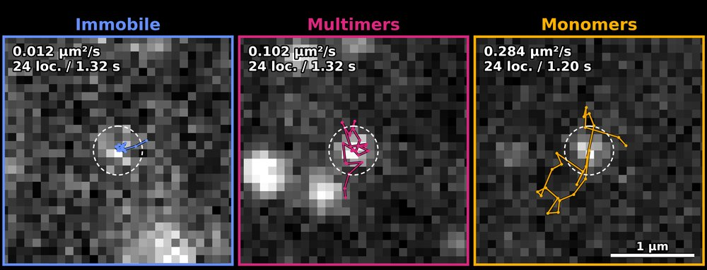

# SPT Trajectory Figures

Publication figures for single-particle tracking (SPT) data: trajectory overlays, saSPT population maps (Immobile / Multimers / Monomers), per-track MSD colouring and representative example tracks.



## Features

- **Trajectory overlays** on the movie frame or on black, with a zoom inset and scale bars.
- **saSPT populations**: each track is assigned to Immobile, Multimers or Monomers from the saSPT diffusion distribution.
- **MSD colouring**: per-track diffusion coefficient, using the Abbelight colour gradient.
- **Representative examples**: one typical track per population, optionally matched in length.
- **Colour-blind-friendly** palettes for all data colours.

## Installation

```bash
git clone <repo-url>
cd <repo>
pip install -r requirements.txt
```

Requires Python 3.9+.

## Quick start

1. Copy `config.example.json` to `config.json` and point it to your data:

   ```json
   {
     "tif": "path/to/movie.tif",
     "tracks": "path/to/tracks.csv",
     "saspt": "path/to/saspt_distribution.csv"
   }
   ```

2. Render the figures:

   ```bash
   python render_figures.py                        # all figures -> figures/
   python render_figures.py --only cover msd_zoom  # a subset
   python render_figures.py --list                 # available figures
   ```

## Input data

| File | Format |
|---|---|
| Movie | Multi-page TIFF. Frame 1 is used as the background. |
| Tracks | CSV with `x`, `y` (pixels), `frame` (1-based) and `trajectory` columns. A `class` column is optional. |
| saSPT distribution | CSV with `Diffusion_Coefficient` (µm²/s) and `Probability_Density` columns. |

Acquisition settings (pixel size 97.5 nm, 40 ms per frame, 35 nm localization error) are in [`common.py`](common.py).

## Figures

| Key | Output | Content |
|---|---|---|
| `saspt` | `saSPT_diffusion_{linear,log}.png` | saSPT distribution with population fractions |
| `state_overlay` | `overlay_trajectories_by_state.png` | Tracks coloured by population, on the movie frame |
| `state_no_image` | `trajectories_by_state_no_image.png` | Same, on black |
| `state_no_image_no_zoom` | `trajectories_by_state_no_image_no_zoom.png` | Same, without the inset |
| `state_multizoom` | `trajectories_by_state_multizoom.png` | Full field of view with one example track per population |
| `examples` | `trajectories_by_state_examples.png` | Representative track per population |
| `examples_matched` | `trajectories_by_state_examples_matched_length.png` | Same, with matched track lengths (24 localizations) |
| `multizoom_matched` | `trajectories_by_state_multizoom_matched_length.png` | Multi-zoom with matched-length examples |
| `abbelight` | `overlay_trajectories_frame0_abbelight_seq_no_zoom_no_image.png` | Tracks coloured by length |
| `msd` | `overlay_trajectories_frame0_abbelight_gradient_msd.png` | Tracks coloured by MSD diffusion coefficient |
| `cover` | `overlay_trajectories_frame0_abbelight_seq_cover.png` | Same, without colour bar or scale bars |
| `msd_zoom`, `cover_zoom` | `..._msd_zoom.png`, `..._cover_zoom.png` | The two above with a zoom on the image centre |

<p align="center">
  <br>
  
</p>

## Using the scripts directly

Each script also runs on its own; use `--help` to see all options.

```bash
# Tracks coloured by population, zoom box centred at (400, 500) px
python overlay_trajectories.py --tif movie.tif --csv tracks.csv --saspt-csv saspt.csv \
    --color-by state --x-center 400 --y-center 500 --out overlay.png

# Tracks coloured by MSD on black, no inset
python overlay_trajectories.py --tif movie.tif --csv tracks.csv \
    --color-by msd --cmap abbelight_gradient --no-image --no-inset

# Length-matched example tracks
python plot_state_examples.py --tif movie.tif --csv tracks.csv --saspt-csv saspt.csv --match-length 24
```

## Methods

- **Population assignment** ([`saspt_classify.py`](saspt_classify.py)). The saSPT distribution is the prior. Each track's jumps give a Brownian likelihood with localization error, and the track goes to the population with the most posterior mass. Cutoffs: Immobile ≤ 0.04 µm²/s < Multimers ≤ 0.18 µm²/s < Monomers.
- **MSD diffusion coefficient** ([`msd.py`](msd.py)). Fits MSD(k) = 4·D·k·Δt + 4σ² over lags of 1–4 frames, with the localization offset fixed. Colours use a rank scale, so each colour covers the same number of tracks.
- **Representative tracks** ([`plot_state_examples.py`](plot_state_examples.py)). Picks the confidently assigned track closest to its population's median D and radius of gyration. Each track is shown on the frame of its first localization.

## Project layout

```
render_figures.py                  # build all figures
overlay_trajectories.py            # trajectory overlay with zoom inset
overlay_trajectories_multizoom.py  # full field of view + three zoom panels
plot_state_examples.py             # representative track per population
plot_saspt_log_vs_linear.py        # saSPT distribution plots
saspt_classify.py                  # per-track population assignment
msd.py                             # per-track MSD diffusion coefficient
colormaps.py                       # ibm_seq, abbelight_seq, abbelight_gradient
common.py                          # constants and shared helpers
```
